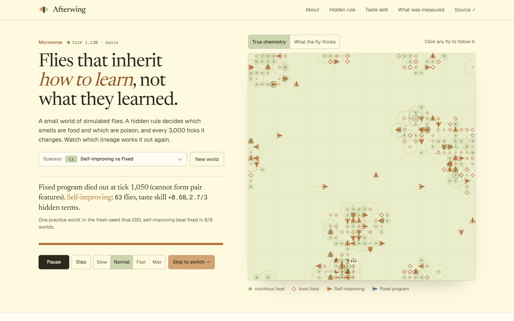
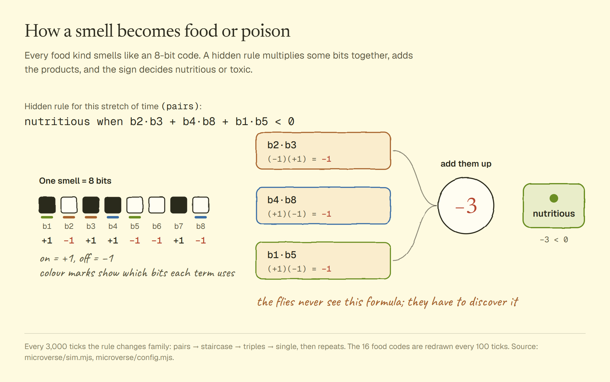
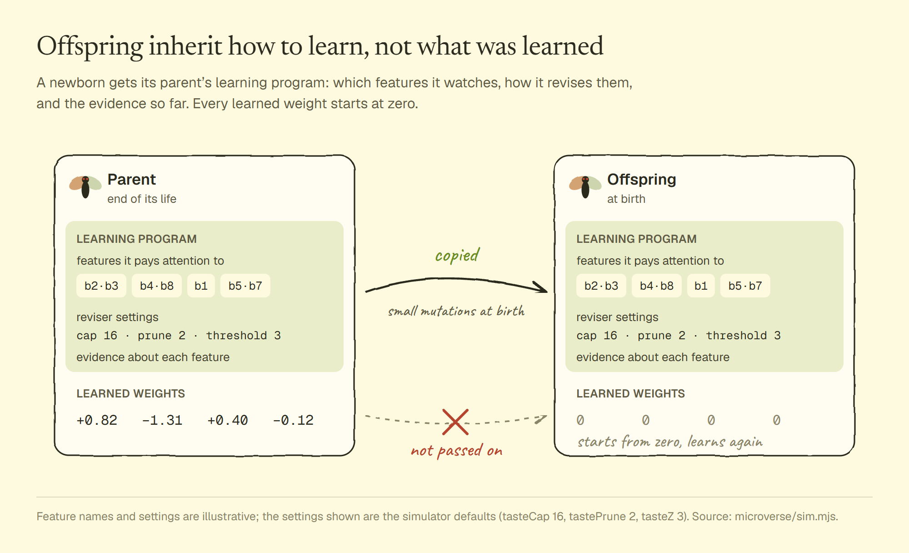
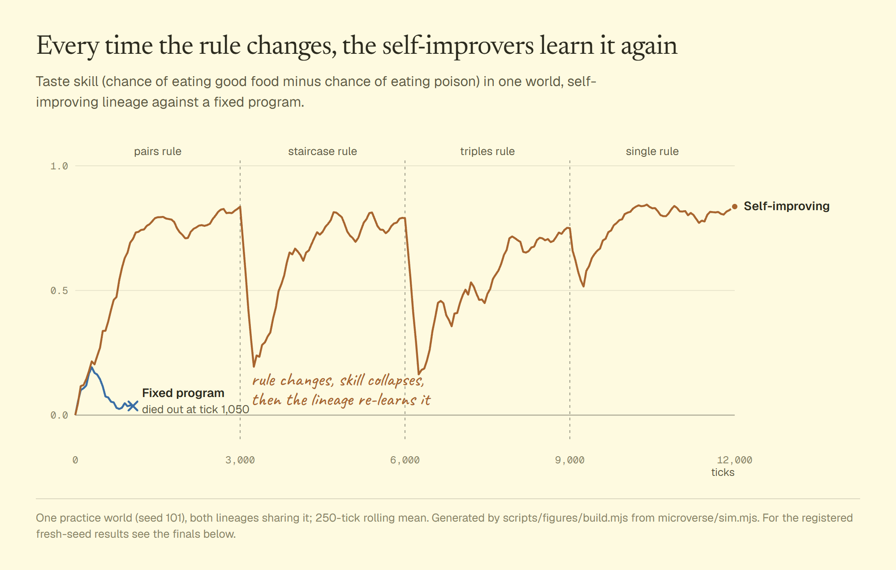
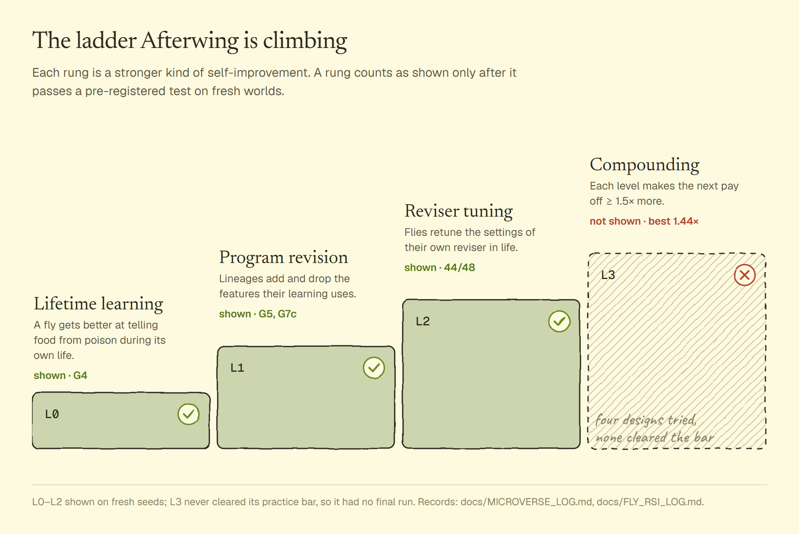
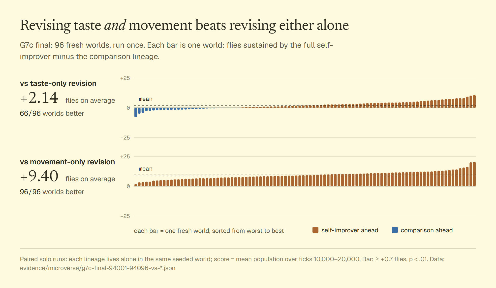
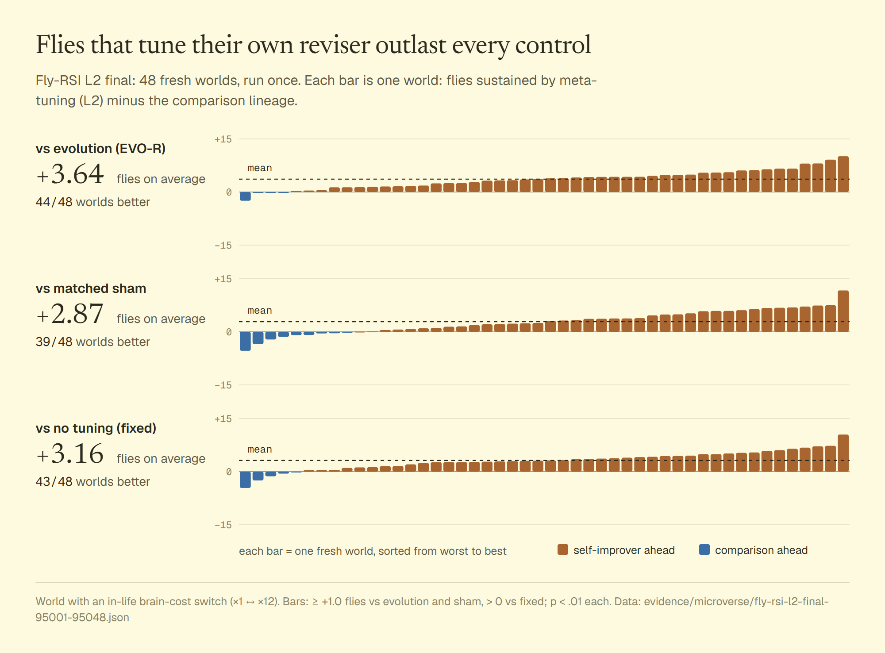
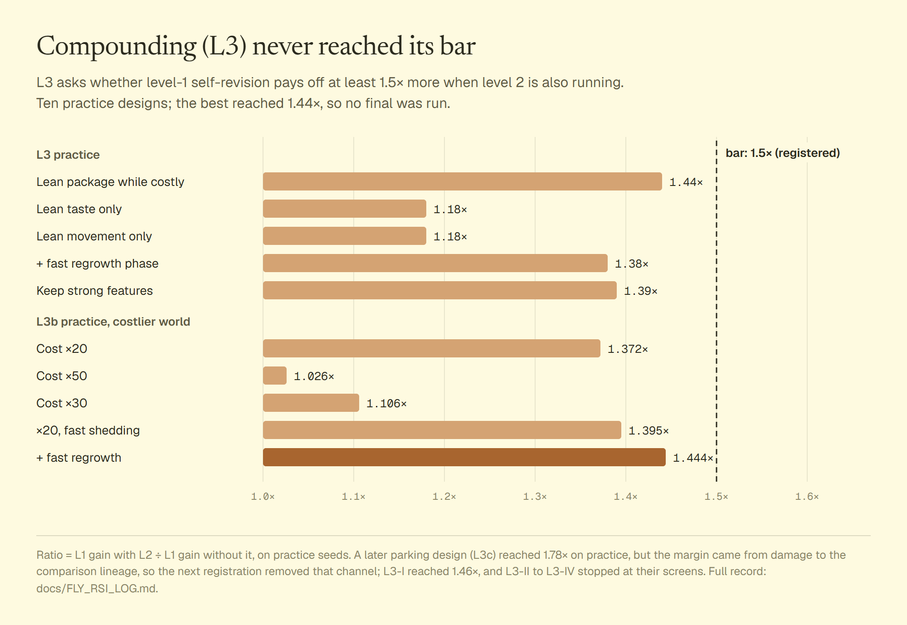
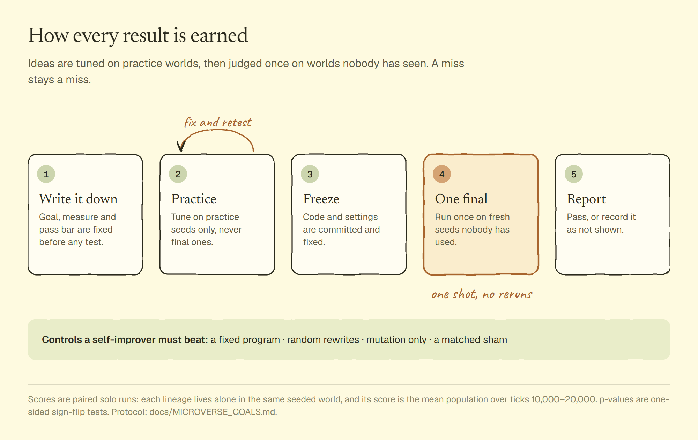

<p align="center">
  
</p>

# Afterwing

**Can a creature improve *how* it learns, not just what it knows, and pass that ability to its offspring?**

Afterwing is an artificial-life research project built to test that question honestly. Its main experiment is the **Microverse**: a closed 40 × 40 world where simulated flies forage, breed and die, while a hidden rule about which food is poison keeps changing under them.

[Watch it run](#run-it) · [What has been shown](#what-has-been-shown) · [Reproduce every number](REPRODUCE.md)

---

## The world



Every food kind smells like an 8-bit code. A hidden formula multiplies some of those bits together and adds the results; the sign says nutritious or toxic. The flies never see the formula. Every 3,000 ticks it switches to a new family (pairs, staircase, triples, single), so whatever a fly worked out stops being true.

## What gets inherited



A newborn gets its parent's **learning program**: which bit combinations it pays attention to, the settings of the reviser that adds and drops them, and the evidence gathered so far. It does **not** get its parent's learned weights. Each fly has to learn the current rule again, but a lineage can get better at learning it.



## What has been shown



| Rung | Claim | Fresh-world result |
|---|---|---|
| **L0** | A fly gets better at telling food from poison during its own life | shown (G4) |
| **L1** | Lineages revise which features their learning uses, from their own evidence | shown: +2.14 flies vs taste-only revision, 66/96 worlds (G7c) |
| **L2** | Flies retune their own reviser in life, from the brain cost they feel | shown: +3.64 flies vs evolution, 44/48 worlds |
| **L3** | Each level makes the next pay off at least 1.5× more | **not shown**: best practice ratio 1.44× |







This is **bounded** self-improvement in a hand-built world. It is not open-ended intelligence, and the flies are not models of real insects.

## How results are earned



Every goal and its pass bar are written down before testing. Designs are tuned on practice seeds only, then judged once on fresh seeds nobody has used, against controls. A miss is recorded as a miss. The simulator is deterministic, so anyone can re-run a final and get the same numbers: see **[REPRODUCE.md](REPRODUCE.md)**.

## Run it

Requires Node.js 22 or newer. There is nothing to install.

```sh
git clone https://github.com/Jaiminp007/fly-ecosystem.git
cd fly-ecosystem
node server.mjs
```

Open <http://127.0.0.1:8765/microverse>. The simulation runs entirely in your browser.

```sh
node --test tests/microverse.test.mjs     # 6 tests, ~10 s: confirms you have the measured world
node microverse/run.mjs 101 6000 SELF,FIXED   # one world, headless
```

## Repository

| Path | Contents |
|---|---|
| `microverse/` | The simulator (`sim.mjs`), lineages (`strains.mjs`) and experiment runners |
| `dist/` | The browser front end |
| `tests/` | Test suite |
| `docs/` | Goals, logs and results for every experiment; [goals](docs/MICROVERSE_GOALS.md), [Microverse log](docs/MICROVERSE_LOG.md), [Fly-RSI log](docs/FLY_RSI_LOG.md) |
| `docs/img/` | Every figure on this page, rebuilt by `node scripts/figures/build.mjs` |
| `evidence/` | Raw output of the recorded runs |
| `handoff/` | Checksummed archives of large run data ([restore](REPRODUCE.md#other-tracks)) |
| `scripts/` | Runners for the other research tracks |
| `connectome/`, `vendor/` | The separate MaleCNS whole-connectome arena |
| `platform/`, `learning/`, `engine.mjs` | Earlier compact-brain platform and learning experiments |

## Other tracks

- **Offline search, P5–P14:** recursive search over the fly's learning program in an opt-in many-odor world. Status and scope: [docs/VISION.md](docs/VISION.md).
- **MaleCNS arena:** flies running the 166,700-neuron MaleCNS v1.0 graph. Needs Python and a C++17 compiler; see [docs/MALECNS.md](docs/MALECNS.md). Its results are separate from the Microverse.

## License

MIT. Third-party code and data notices are in [THIRD_PARTY.md](THIRD_PARTY.md).
